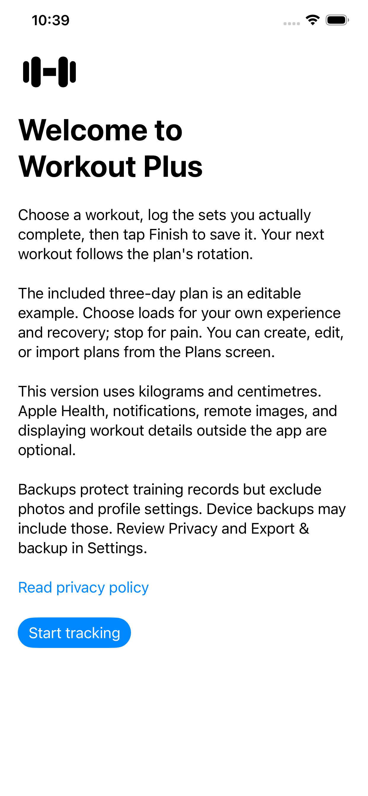
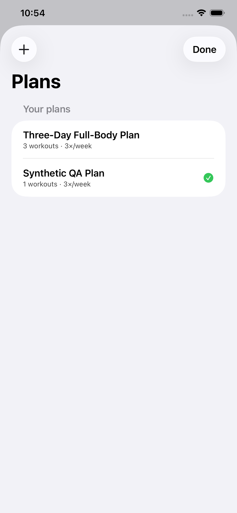

# Workout Plus

An iPhone workout tracker built with SwiftUI and SwiftData. Log sets, follow a
plan rotation, view training history and progress, record body measurements,
and optionally sync with Apple Health. Includes a widget and Live Activities.

Requires iOS 26 or later. This release uses kilograms and centimetres.

## Build

1. Open `Workout Plus.xcodeproj` with Xcode 26 or later.
2. Select the **Workout Plus** scheme and an iPhone simulator, then run.
3. For a physical iPhone, copy the settings from `Config/Project.xcconfig` into
   an ignored `Config/Signing.local.xcconfig`. Set a development team, a unique
   bundle identifier, and an App Group registered for that team. Both app and
   widget use those settings.

Do not change identifiers for an already installed personal copy unless you
intend to create a separate app/container. Existing local signing overrides
can preserve its installation and stored data.

```xcconfig
WORKOUT_DEVELOPMENT_TEAM = YOUR_TEAM_ID
WORKOUT_BUNDLE_IDENTIFIER = com.example.workoutplus
WORKOUT_APP_GROUP = group.com.example.workoutplus
```

Free-account development builds may require periodic signing renewal. See
[SIGNING-RENEWAL.md](SIGNING-RENEWAL.md). Consumers should use a distributed build,
not a weekly development-signing workflow.

## Plans and sample JSON

Use **Workouts → Plans** to create or edit a plan; swipe a plan to edit it.
Alternatively import a JSON file or paste JSON. The file is a plan, not a
training-history backup.

- [Minimal JSON example](Examples/minimal-plan.json): easiest starting point.
- [Three-day full-body plan](Examples/three-day-full-body.json): a sanitized
  example preserving the latest plan's exercise selection, set counts, rep
  ranges, and A/B/C rotation. No personal performances, dates, starting loads,
  symptoms, or equipment-history commentary are included.
- [Format guide](Docs/PLAN-FORMAT.md) and [JSON Schema](Examples/plan.schema.json).

The three-day example is also the fresh-install starter plan. It is an editable
example, not an individualized training prescription. Select appropriate loads,
reduce volume when necessary, and get instruction for unfamiliar movements.

## Screenshots

Captured from the isolated simulator with synthetic data.




## Privacy and backups

Logs and photos live in the app container; there is no app account or analytics
SDK. Health, remote images, notifications, and workout details in widgets/Live
Activities are optional. Remote image downloads are off by default and limited
to the supported exercise library hosted on GitHub.

Training-data JSON backups include plans, sessions, sets, and measurements.
They exclude photos and optional profile/settings. Exports are unencrypted;
share them carefully. Device backups may separately contain app data and photos.
Use Settings to erase local data and optionally linked app-created Health data.
Read the [privacy policy](PRIVACY.md) and [support information](SUPPORT.md).

## Development and release

Run `bash Tools/run_checks.sh` for the focused data-safety checks and sample-plan
validation. CI builds app/widget Debug and Release with signing disabled.
Run `bash Tools/run_ui_checks.sh` after installing an iOS 26+ simulator runtime
to exercise onboarding, plan creation, and privacy controls on an isolated
simulator. It exports screenshots into ignored `TestResults/`.
[Release checklist](Docs/RELEASE-CHECKLIST.md) tracks what requires a signed
archive, physical devices, Apple account access, and beta feedback.

Original project material is licensed under the
[PolyForm Noncommercial License 1.0.0](LICENSE), with required attribution to
**Parham Rahimi** in [NOTICE](NOTICE). This is source-available software, not
OSI-approved open-source software. Noncommercial use, modification, and
redistribution are permitted under the license, including its explicit
organizational permissions. General commercial use, resale, and commercial
use of derivative versions are not granted by this license; contact the author
for separate permission. The actual license terms control this summary.

Keep the required notice and license terms with redistributed copies.
Exercise imagery has separate
[third-party provenance](THIRD-PARTY-NOTICES.md). See
[contribution guidance](CONTRIBUTING.md) and [security reporting](SECURITY.md).
